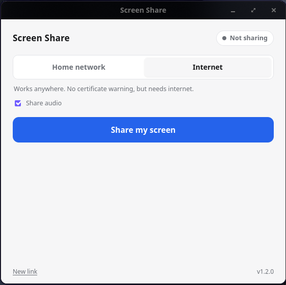

# Linux Screen Share

A simple app to share any Linux device screen to a smart TV or any browser over
the network, local or remote, easily.



Press one button, copy the link or scan the QR code, and the screen is live on
the other device. No accounts, no setup wizard, and no package manager or
command line knowledge required. The app carries its own streaming engine,
viewer, and tunnel client.

## Quick start

```sh
curl -fsSL https://raw.githubusercontent.com/Husseinkizz/linux-share-screen/main/install.sh | sh
```

The script downloads the latest AppImage, verifies its SHA-256 checksum,
installs it for the current user, and adds a desktop entry. Pin a version with
`LSS_VERSION=1.2.0`, or remove it later with `./install.sh --uninstall`.

Prefer a package manager or the archive installer? See Install below.

## What it does

- Shares the real desktop on Wayland (COSMIC, Sway, Hyprland) and X11.
- Works on the home network or over the internet through a Cloudflare tunnel.
  Internet mode gets a valid HTTPS address, so TV browsers connect without
  certificate warnings.
- Keeps the link stable between sessions. A single button rotates it.
- Streams 1080p at up to 60 frames per second with adaptive bitrate.
- Shares desktop audio with a Sound on and Sound off control in the viewer.
- Shows one small window with one primary action.

## Install

### Debian and Ubuntu (.deb)

Download `screen-share_<version>_amd64.deb` and open it in the software
center, or run:

```sh
sudo apt install ./screen-share_<version>_amd64.deb
```

APT installs the required libraries automatically, including WebKitGTK. The
app then appears in the application menu as Linux Screen Share.

### AppImage

1. Download `Linux-Screen-Share-x86_64.AppImage` from the releases page.
2. `chmod +x Linux-Screen-Share-x86_64.AppImage`
3. Run it, or double click it.

The AppImage uses the WebKitGTK libraries already present on the system. If
the app does not start, install them with the commands further down. Some
distributions ship FUSE 3 only, in which case run:

```sh
./Linux-Screen-Share-x86_64.AppImage --appimage-extract-and-run
```

### Installer archive

Download `stable-linux-x64-ScreenShare-Setup.tar.gz`, extract it, and run
`./installer`. The app installs to `~/.local/share` and adds a desktop
shortcut. No administrator rights are needed.

### If the app does not start

The app needs GTK 3 and WebKitGTK 4.1. Both are present on current desktop
installs. To add them manually:

```sh
# Debian, Ubuntu, Pop!_OS
sudo apt install libwebkit2gtk-4.1-0 libgtk-3-0

# Fedora
sudo dnf install webkit2gtk4.1 gtk3

# Arch, Manjaro
sudo pacman -S webkit2gtk-4.1 gtk3

# openSUSE
sudo zypper install libwebkit2gtk-4_1-0 gtk3
```

Home network mode also uses `openssl` to create a local certificate. Mainstream
distributions include it.

## Use

1. Open Screen Share.
2. Choose a mode:
   - Internet: works on any network, including TVs. Recommended. A new link
     can take up to a minute before other devices resolve it.
   - Home network: direct connection on the same Wi-Fi. The other device shows
     a certificate warning once.
3. Press Share my screen.
4. On the other device, open the copied link or scan the QR code.

Stop sharing with Stop sharing. Closing the app always stops the session.

## Known limitations

- Audio comes from the default output monitor. Bandwidth rises by about
  1.5 Mbps while unmuted. Microphone capture is not available yet.
- Mouse control is not available on COSMIC. Typing works. The compositor does
  not expose a pointer injection protocol.
- The viewing device needs WebCodecs H.264 support. Most desktop browsers and
  recent Android TVs have it. Some TV browsers do not. An MSE fallback is
  planned.
- Home network mode uses a self signed certificate. Some TV browsers refuse to
  continue past the warning. Internet mode avoids this.
- Internet mode uses a new random `trycloudflare.com` address each session.
  Named tunnels and custom domains are planned.
- A fresh internet link can take up to a minute before DNS resolves on other
  devices. If the page does not load at first, wait and reload.
- One display at a time. Linux x86_64 only.

## Requirements

- Linux x86_64 with a GTK 3 and WebKitGTK 4.1 desktop.
- A Wayland or X11 session.
- Internet access for tunnel mode. Home network mode works offline.

## Build from source

Requirements: Bun 1.4 or newer, a C++ toolchain, and the engine build
dependencies.

```sh
git clone https://github.com/Hussseinkizz/linux-share-screen.git
cd linux-share-screen
bun install

# Debian and Ubuntu example
sudo apt install build-essential pkg-config libwebsockets-dev libx264-dev \
  libcap-dev zlib1g-dev libwayland-dev wayland-protocols libxkbcommon-dev \
  libx11-dev libxdamage-dev libxfixes-dev libxtst-dev \
  libgtk-3-dev libwebkit2gtk-4.1-dev pulseaudio-utils dpkg-dev

bun run fetch:cloudflared
bun scripts/bootstrap-engine.sh
LSS_SCREEN_RELAY=.engine/screen-relay bun run resources

bun run start
bun run package
```

Checks:

```sh
bun run typecheck
bun run smoke lan
bun run smoke internet
```

### Release

```sh
bun run release 1.0.1
```

The script bumps versions, builds the installer and AppImage, commits, tags,
pushes, and creates the GitHub release with checksums.

Sharing internals are documented in `docs/ARCHITECTURE.md` for contributors.

## Credits

- screen-relay by Vercel Labs (https://github.com/vercel-labs/screen-relay):
  the streaming engine, wire protocol, and web viewer this app builds on. This
  project would not exist without it.
- Electrobun (https://github.com/blackboardsh/electrobun): the desktop
  framework.
- cloudflared (https://github.com/cloudflare/cloudflared): internet mode
  tunnels.
- Bun (https://bun.sh): runtime and tooling.
- x264 (https://www.videolan.org/developers/x264.html): video encoding.
- The authors of the ext-image-copy-capture protocol and the COSMIC desktop.

Third party licenses are listed in `THIRD-PARTY.md`.

## License

GNU General Public License version 2. See `LICENSE`. The bundled screen-relay
components remain Apache 2.0 and cloudflared remains Apache 2.0. Details are in
`THIRD-PARTY.md`.

## Roadmap

AppImage with bundled WebKit. MSE fallback for TVs. Microphone capture. Named
tunnels. Virtual desktop mode with mouse control. Multi monitor picker.
